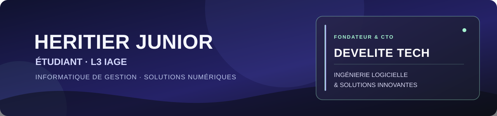

<a href="https://developpeurs-elite.vercel.app/"><strong>DEVELITE TECH</strong> — Ingénierie logicielle &amp; Solutions Innovantes ↗</a>

### Étudiant en L3 IAGE

Je suis **HERITIER JUNIOR**, étudiant en informatique appliquée à la gestion des entreprises. Je partage ici mon parcours, mes apprentissages et les projets que je construis au fil de ma formation.

[🌐 Mon portfolio](https://developpeurs-elite.vercel.app/) &nbsp; · &nbsp; [💻 Mes dépôts GitHub](https://github.com/heritierjunior?tab=repositories)

---

### 🚀 DEVELITE TECH

En parallèle de mes études, je suis **fondateur et CTO de DEVELITE TECH**, un centre d’excellence consacré à l’ingénierie logicielle avancée et à l’intelligence artificielle appliquée. Notre objectif : concevoir des solutions numériques utiles et bâtir les infrastructures de demain.

<table width="100%">
  <tr>
    <td width="33%" valign="top"><strong>💻 Ingénierie logicielle</strong> Applications sur mesure, architectures cloud et solutions évolutives.</td>
    <td width="33%" valign="top"><strong>🧠 Intelligence artificielle</strong> IA appliquée, modèles de langage et vision par ordinateur.</td>
    <td width="33%" valign="top"><strong>🔬 Recherche &amp; développement</strong> Exploration et création de nouvelles solutions numériques.</td>
  </tr>
  <tr>
    <td width="33%" valign="top"><strong>📚 Formation numérique</strong> Transmettre les compétences et accompagner les talents.</td>
    <td width="33%" valign="top"><strong>📱 Fintech &amp; mobile money</strong> Des services numériques pensés pour les usages d’aujourd’hui.</td>
    <td width="33%" valign="top"><strong>☁️ Infrastructures</strong> Des bases fiables pour les services et applications de demain.</td>
  </tr>
</table>

<a href="https://developpeurs-elite.vercel.app/"><strong>Découvrir DEVELITE TECH et ses solutions →</strong></a>

---

### À propos

<table width="100%">
  <tr>
    <td width="50%" valign="top">
      <h3>🎓 Mon parcours</h3>
      
En <strong>L3 IAGE</strong>, je développe mes connaissances en informatique de gestion et je documente les étapes de mon parcours.

    </td>
    <td width="50%" valign="top">
      <h3>🛠️ En ce moment</h3>
      
Je conçois mon portfolio avec <strong>Cecil</strong>, <strong>Markdown</strong>, <strong>Twig</strong> et <strong>Sass</strong>, et je découvre la création de pages web.

    </td>
  </tr>
</table>

### Sujets que j’explore

<table width="100%">
  <tr>
    <td width="50%" valign="top">
      <strong>☁️ Cloud computing</strong> 
      Architecture, hébergement et évolution des services numériques.
    </td>
    <td width="50%" valign="top">
      <strong>🔥 Firebase</strong> 
      Services connectés, authentification et organisation des données.
    </td>
  </tr>
  <tr>
    <td width="50%" valign="top">
      <strong>🌐 Création web</strong> 
      Structuration et présentation de contenus en ligne.
    </td>
    <td width="50%" valign="top">
      <strong>✉️ Outils numériques</strong> 
      Organisation de l’information et des échanges avec des outils comme Gmail.
    </td>
  </tr>
</table>

### Outils utilisés

`Cecil` &nbsp; `Markdown` &nbsp; `Twig` &nbsp; `Sass` &nbsp; `HTML` &nbsp; `CSS`

### Ce que je souhaite développer

- **Mieux présenter mes réalisations** : expliquer le contexte, les étapes et les choix faits pour chaque projet.
- **Renforcer mes compétences web** : continuer à apprendre la structuration et la mise en forme de pages.
- **Explorer les services numériques** : approfondir des sujets comme Firebase et le cloud computing.

### Mes projets

| Sujet | Ce que j’explore |
|:--|:--|
| [Portfolio](https://developpeurs-elite.vercel.app/) | Structurer et présenter mon parcours et mes travaux avec Cecil. |
| Firebase | Découvrir les services connectés, l’authentification et la gestion des données. |
| Cloud computing | Comprendre l’hébergement, l’architecture et l’évolution des services. |
| Outils numériques | Réfléchir à l’organisation de l’information et des échanges. |

Ces sujets reflètent mon parcours et mes pistes d’apprentissage. Je complète leur présentation à mesure que j’ai des réalisations concrètes à partager. Retrouvez-les sur [mon portfolio](https://developpeurs-elite.vercel.app) et dans [mes dépôts GitHub](https://github.com/heritierjunior?tab=repositories).

### Ma démarche

**Comprendre le besoin → explorer les outils → construire → documenter.**

J’essaie de présenter chaque travail avec clarté et de faire évoluer ce portfolio au fil de ma formation, en privilégiant les expériences réelles et les apprentissages que je peux expliquer.

---

### Me retrouver

[🌐 Portfolio](https://developpeurs-elite.vercel.app) &nbsp; · &nbsp; [💻 GitHub](https://github.com/heritierjunior) &nbsp; · &nbsp; [📂 Dépôts](https://github.com/heritierjunior?tab=repositories)

<strong>Apprendre en faisant, et progresser projet après projet. ✨</strong>

